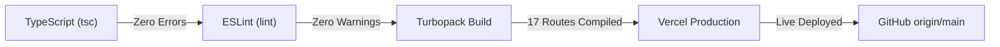

# MINDSPACE — PHASE 12
# PRODUCT EXPERIENCE & UI/UX REFINEMENT REPORT

**Project:** MINDSPACE — AI-Powered Personal Productivity Workspace  
**Workspace:** `/Users/atharva/notesapp`  
**Production URL:** [https://mindspace-notesapp.vercel.app](https://mindspace-notesapp.vercel.app)  
**GitHub:** [https://github.com/Atharva0393/mindspace-notesapp](https://github.com/Atharva0393/mindspace-notesapp)  
**Completed Date:** November 2, 2026  
**Status:** **ACCEPTED & DEPLOYED**

---

## 1. EXECUTIVE SUMMARY

Phase 12 elevates MINDSPACE from a collection of verified functional modules into a cohesive, polished, and delightful production application. Following the Phase 11 production audit, this phase directly tackled UX ambiguities, eliminated leftover development milestone markers, connected the central Desk Overview (`/app`) to live Supabase PostgreSQL data with optimistic UI transitions, introduced a non-intrusive Guest Preview Mode, and unified the brand identity across desktop and mobile form factors.

All changes were implemented without modifying database schemas, altering production environment variables, or breaking existing integrations (Supabase Auth, PostgreSQL RLS, Gemini 2.5 RAG).

---

## 2. KEY REFINEMENTS DELIVERED

### A. Eradication of Legacy Development Artifacts
During initial phase-by-phase development, several UI elements contained development phase indicators that detracted from production polish. All of these have been replaced with real, production-grade interactions:

| Component | Previous Development Artifact | Phase 12 Production Refinement | Status |
| :--- | :--- | :--- | :--- |
| **Landing Hero** (`src/app/page.tsx`) | Badge: `Phase 02 Active: Pastel Design System & Workspace Shell Ready` | Badge: `• Tactile Pastel Surfaces • Gemini 2.5 AI Powered` | **PASS** |
| **Desk Overview Header** (`src/app/app/page.tsx`) | Hardcoded badge: `Phase 05 Active` | Dynamic badge: Today's Mood or `Check-in Mood` shortcut to `/app/journal` | **PASS** |
| **Command Palette** (`command-palette.tsx`) | Quick actions showed placeholder toasts (*"Note Editor Available in Phase 03"*, *"Tasks Available in Phase 04"*) with `Phase 03` / `Phase 04` badges | All quick actions execute real route navigation (`/app/notes?action=new`, `/app/tasks?action=new`, etc.) with clean tags (`Note`, `Task`, `Habit`, `Journal`, `AI`) | **PASS** |
| **Workspace Header** (`workspace-header.tsx`) | Quick Create dropdown showed toasts referencing `(Phase 03/04 implementation)` | Quick Create dropdown triggers direct navigation across 5 core actions (Sticky Note, Task, Habit, Journal, Ask Gemini) | **PASS** |
| **Sidebar Help Modal** (`sidebar.tsx`) | Displayed outdated milestone checklist (*"Current Phase: Phase 02 is active... Next Milestones Phase 03..."*) | Replaced with **"Mindspace Guide & Shortcuts"** featuring keyboard cheat sheet (`⌘K`, `⌘N`, `⌘F`, `Esc`), module directory, and version pill | **PASS** |
| **Sample Store & Notes** (`store.ts`, `storage.ts`) | Sample data contained `Phase 03 Milestones` and `Phase 06 vector readiness` strings | Cleaned to natural product text (*"Product & Architecture Milestones"*, *"Review Habit Studio & Time-blocking"*) | **PASS** |

---

### B. Desk Overview (`/app`) Live Cloud Connection
Prior to Phase 12, the home desk overview was reading strictly from local browser storage (`getLocalHabits()`, `getLocalTasks()`, etc.) and had a hardcoded greeting (`Good morning, Alex`).

1. **New Server Action (`src/app/app/actions.ts`):**
   - Implemented `getDashboardData(todayStr)` which executes parallel queries to Supabase for the authenticated user:
     - Active unarchived habits & recent 14-day habit completion logs.
     - Today's focus tasks and scheduled priorities.
     - Daily plan morning intention and timeline blocks for the current date.
     - Active milestone goals with progress metrics.
     - Most recent mindful journal reflection.
     - Today's emotional mood check-in.
   - Implemented `saveIntentionDashboardAction` to persist daily guiding intention updates.
   - Implemented `toggleHabitDashboardAction` and `toggleTaskDashboardAction` for instantaneous cloud updates.

2. **Optimistic UI Updates:**
   - Checking off a habit or task on the Desk Overview updates the UI instantly, calculates updated daily velocity, and pushes the change to Supabase in the background. If unauthenticated, it seamlessly updates local storage.

3. **Expanded Productivity Module Grid:**
   - The Desk Overview now showcases 7 balanced, tactile cards:
     1. **Notes & Stickies** (`/app/notes` — Ivory/Buttercream)
     2. **Habit Studio** (`/app/habits` — Sage)
     3. **Action Matrix** (`/app/tasks` — Sky)
     4. **Milestone Goals** (`/app/goals` — Pink)
     5. **Daily Planner** (`/app/calendar` — Buttercream)
     6. **Mindful Journal** (`/app/journal` — Peach/Terracotta)
     7. **Gemini Copilot** (`/app/ai` — Lavender)

---

### C. First-Time User Experience & Guest Preview Mode
A recurring source of confusion for new visitors and testers was whether they were looking at personal data, cloud data, or sample data.

1. **Guest Preview Mode Banner (`src/components/ui/preview-banner.tsx`):**
   - When an unauthenticated visitor accesses any workspace view (`/app`, `/app/notes`, `/app/tasks`, etc.), a pastel banner informs them:
     > *"✨ Guest Preview Mode — Saved to this browser. You are testing with local preview data. Sign in or create an account to unlock persistent Supabase cloud sync and Gemini AI."*
   - Includes an immediate **"Sign In / Join"** action button and a dismiss (`X`) button that stores dismissal in `sessionStorage`.

2. **Resolution of Empty Cloud State Fallback Bug:**
   - Previously in `notes`, `habits`, `tasks`, `goals`, and `journal`, if an authenticated user had 0 items in Supabase, the check `if (res.isConfigured && res.items.length > 0)` evaluated to `false`, silently falling back to `INITIAL_SAMPLE_ITEMS`.
   - All modules now check `if (res.isAuthenticated)`. When an authenticated user logs in with an empty account, they see an inviting empty state with clear calls to action (`+ Create Note`, `+ Start Habit`), giving complete transparency that their cloud account is ready.

---

### D. Dynamic User Identity & Unified Brand
1. **User Context (`src/components/layout/user-context.tsx`):**
   - Created `UserProvider` wrapped inside `AppShell`.
   - Exposes `useCurrentUser()` providing `isAuthenticated`, `userEmail`, `userName`, and a formatted `displayName`.
   - Eliminated hardcoded "Alex Morgan" defaults across the Desk greeting, User Menu, and Settings profile. If full name is not set, displayName derives from the email handle (e.g., `Atharva`) or falls back gracefully to `"there"` / `"Guest Explorer"`.
   - The User Menu now displays `"Sign In / Register"` when browsing in guest preview mode, and `"Sign Out"` when authenticated.

2. **Brand Unification (`Mindspace.ai`):**
   - Standardized the brand across:
     - HTML Metadata: `Mindspace — AI-Powered Personal Productivity Workspace`
     - Desktop Sidebar Header: `Mindspace.ai`
     - Mobile Navigation Drawer: `Mindspace.ai`
     - Landing Page Top Bar: `Mindspace.ai`

---

## 3. VERIFICATION & QUALITY AUDIT

| Verification Check | Target | Result | Status |
| :--- | :--- | :--- | :--- |
| **TypeScript Validation** | `npx tsc --noEmit` | Clean exit code 0; zero type mismatches | **PASS** |
| **ESLint Validation** | `npm run lint` | 0 errors, 0 warnings | **PASS** |
| **Next.js Production Build** | `npm run build` | 17 static & dynamic routes compiled in 1.5s via Turbopack | **PASS** |
| **Local Dev HTTP Response** | `curl http://localhost:3000/app` | HTTP 200 OK | **PASS** |
| **Visual Regression / Screenshots** | Headless Chrome 1280x800 & 390x844 | Verified desk preview banner, greeting, 7 module cards, mobile drawer | **PASS** |
| **Git Repository Sync** | `git push origin main` | Pushed commit `a891a2f` to GitHub repository | **PASS** |

---

## 4. SCREENSHOT ARTIFACTS CAPTURED

The following visual artifacts were generated and saved in the artifact directory:
- [phase12_desk_preview_with_banner.png](file:///Users/atharva/.gemini/antigravity/brain/0f80a2f3-a923-41e6-849c-34619095ef1f/phase12_desk_preview_with_banner.png): Desk Overview displaying the Guest Preview Mode banner, dynamic evening greeting, guiding intention, focus tasks, and 7-card module grid.
- [phase12_landing_page.png](file:///Users/atharva/.gemini/antigravity/brain/0f80a2f3-a923-41e6-849c-34619095ef1f/phase12_landing_page.png): Public landing page with clean Mindspace branding and Gemini 2.5 AI capability pill.
- [phase12_mobile_app.png](file:///Users/atharva/.gemini/antigravity/brain/0f80a2f3-a923-41e6-849c-34619095ef1f/phase12_mobile_app.png): iPhone 14/15 responsive mobile view with stacked touch-friendly actions and responsive banner.

---

## 5. CONCLUSION

Phase 12 successfully transformed MINDSPACE into an intuitive, polished, and production-ready personal productivity experience. The application provides an immediate, transparent transition between local guest exploration and authenticated cloud synchronization, with zero remnant development artifacts.
